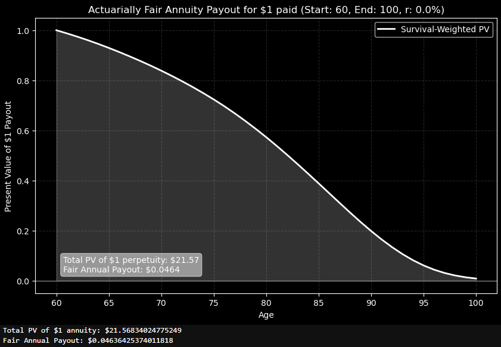
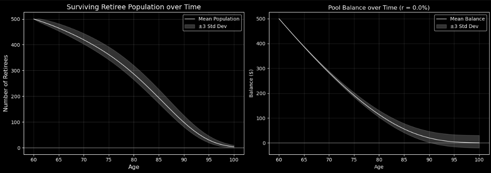
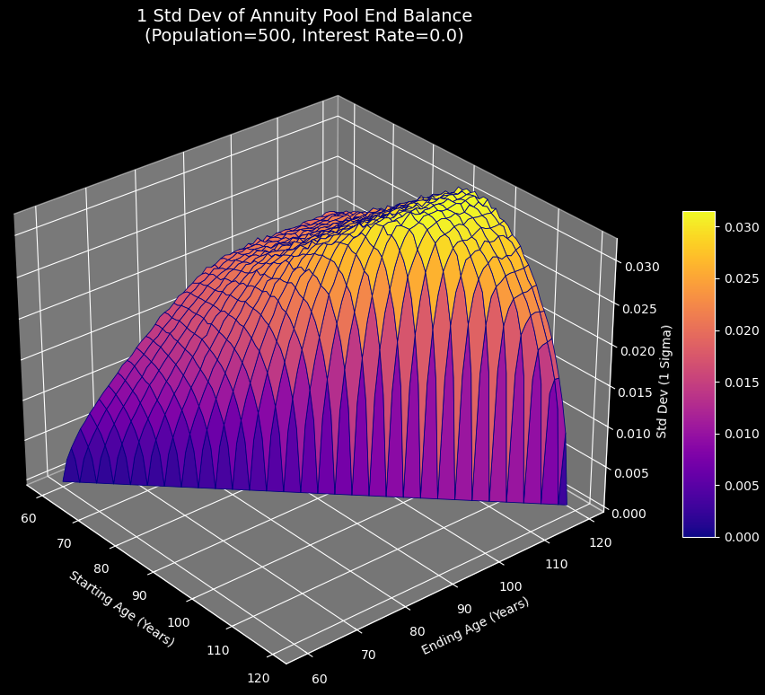
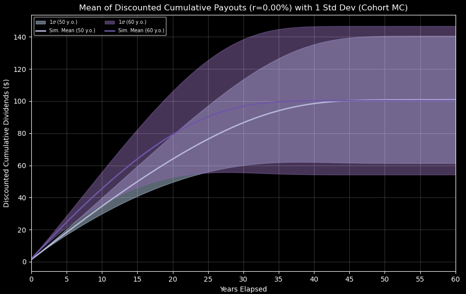
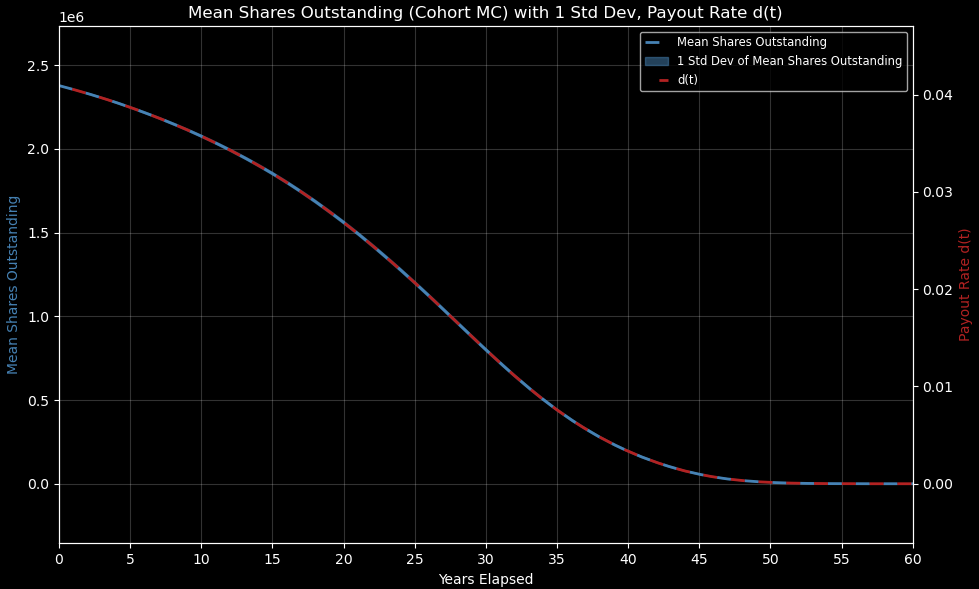
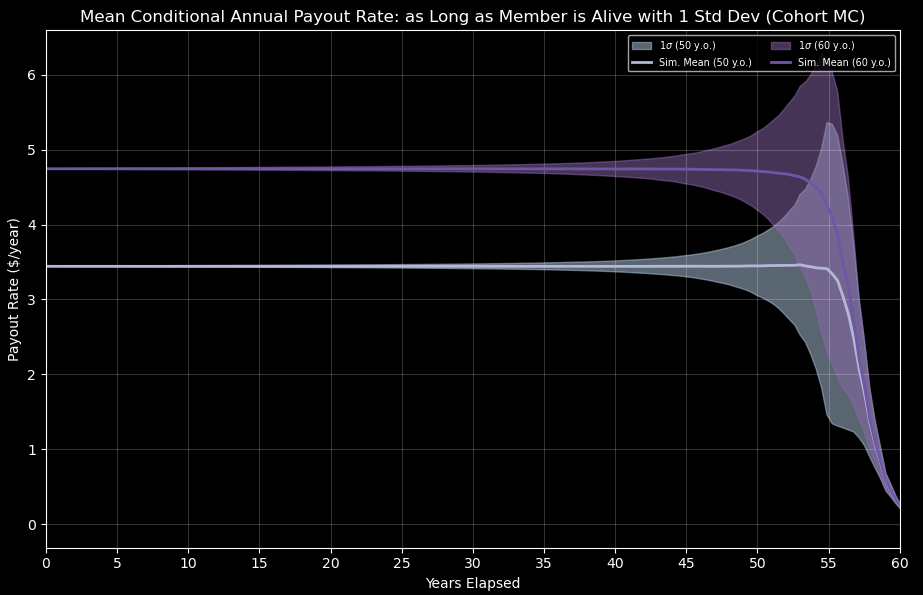

# Fair Tontine Toolbox

Jupyter notebooks that price equitable participation rates (π) for mixed-cohort retirement tontines, with visuals and simulations built on Milevsky & Salisbury (2016).

**Disclaimer:** This project is for research and educational purposes only. It is not financial, investment, or actuarial advice.

## The problem

A tontine is a pool where members put in capital and receive income for as long as they live. When a member dies, their share stays in the pool and goes to the survivors. Nobody guarantees the payments, so no insurer has to hold capital against people living longer than expected. That is what makes a tontine cheaper than an annuity: the pool carries its own longevity risk.

The catch appears when members differ. Put a 50-year-old and a 70-year-old in the same pool on equal terms, and the 50-year-old can expect to collect for many more years, largely funded by what the 70-year-old leaves behind. The same happens when one member invests far more than the rest. Without an adjustment, one group quietly subsidizes another. The usual workaround is a separate pool for each age band, but that makes every pool smaller and its payouts more volatile.

## The fix: participation rates

Milevsky & Salisbury (2016) show that a mixed pool can be fair if each member's claim is scaled by a **participation rate π**. A member's claim on each payout is `π × amount invested`, so π > 1 gives someone more than one share per dollar to make up for a lower chance of being alive to collect.

The pool is fair when every member gets the same expected present value per dollar invested, whatever their age, sex, or contribution size. This toolbox solves for the π values that achieve that.

For example, take a pool of forty men, ten each aged 40, 50, 60, and 70, each investing $100 (SSA mortality, 3% interest):

| Age | π    |
|-----|------|
| 40  | 1.00 |
| 50  | 1.17 |
| 60  | 1.47 |
| 70  | 2.00 |

A 70-year-old needs about twice the claim per dollar of a 40-year-old to get an equally good deal. In a two-cohort pool of 100 fifty-year-olds and 100 seventy-year-olds, the older cohort's π comes out at 1.69.

## Example results

Pre-rendered outputs from the notebooks. You can view them here without running anything.

Survival-weighted present value of a $1 payout, ages 60–100, r = 0% (fair annual payout ≈ $0.046):



Annuity-pool Monte Carlo: surviving population and pool balance with ±3σ bands:



1σ of end balance vs start/end age (N = 500, r = 0%):



Mixed 50- and 60-year-old cohorts (20,000 members): mean discounted cumulative payouts ±1σ:



Same pool: mean shares outstanding and payout rate d(t):



Same pool: conditional annual payout while alive ±1σ:



[Full plot gallery](docs/RESULTS.md)

## How it works

1. **Mortality.** Death probabilities from the SSA period life table are turned into survival curves. They are also compared with the Gompertz law used in the paper.
2. **Payout schedule.** The pool's total payout rate over time, d(t), is a capital-weighted blend of each member's "natural" payout rate: survival probability divided by annuity factor. This is the optimal schedule for a log-utility investor.
3. **Solving for π.** Both solvers start every π at 1. They then repeatedly raise π for whoever currently has the worst deal until all expected values are equal.
   - **Combinatorial state solver** (cohorts of identical members): enumerates every combination of survivors to get exact expected values. The number of states grows as the product of (cohort size + 1), so it is only practical for a few cohorts.
   - **Delta-method approximator** (every member can be different): estimates each member's expected share of payouts with a second-order Taylor expansion. It scales to large pools at the cost of a small approximation error.
4. **Checking the result.** Monte Carlo simulation of the solved pool shows payout paths and their spread. Each member gets a lifetime log-utility score. The outlier notebook replicates the paper's curves showing how π moves for a single member whose age or contribution differs from the rest of the pool.

## Assumptions and limitations

- Log utility (γ = 1) only. The natural payout schedule is optimal only in that case.
- A constant risk-free rate (3% by default) and no investment risk.
- A 2021 period life table with no future mortality improvement, and deaths assumed independent.
- The exact solver's cost grows exponentially with the number of cohorts. Use the delta method for anything larger.
- This is a pricing model, not a product. Fees, adverse selection, lapses, and regulation are out of scope.

## Requirements

- Python 3.10+
- Dependencies: `pip install -r requirements.txt`

## How to run

Open Jupyter from the project root (imports assume the working directory is the repo root):

```bash
jupyter notebook
```

Suggested notebook order:

1. `TontineToolboxQXVisualizer.ipynb` — sanity-check mortality tables (empirical qx vs. Gompertz from the paper)
2. `TontineToolboxAnnuity.ipynb` — fair annuity payouts and pool volatility (baseline before tontine mechanics)
3. `TontineToolboxMain.ipynb` — core π solvers and pool simulation
4. `TontineToolboxOutlierMath.ipynb` — replicate Milevsky & Salisbury outlier curves (optional, paper-focused)

## References

### Mortality data

U.S. Social Security Administration, Period Life Table 4C6 (2021 period, as used in the 2024 Trustees Report).  
https://www.ssa.gov/oact/STATS/table4c6.html

### Academic sources

This repository implements and extends the framework in:

> Milevsky, M. A., & Salisbury, T. S. (2016). *Equitable Retirement Income Tontines: Mixing Cohorts Without Discriminating.* ASTIN Bulletin, 46(3), 571–604.  
> [Cambridge](https://www.cambridge.org/core/journals/astin-bulletin-journal-of-the-iaa/article/equitable-retirement-income-tontines-mixing-cohorts-without-discriminating/3174FE869098E8E47A738CC1C2E06A86) · [SSRN](https://ssrn.com/abstract=2700362)

Related (natural tontine / Gompertz parameters used in the QX visualizer):

> Milevsky, M. A., & Salisbury, T. S. (2015). *Optimal Retirement Income Tontines.* Insurance: Mathematics and Economics, 64, 91–105.

This project is **not affiliated with or endorsed by** the authors.

## License

MIT License — see [LICENSE](LICENSE). Mortality data is U.S. government data; cite SSA as the source when redistributing.
